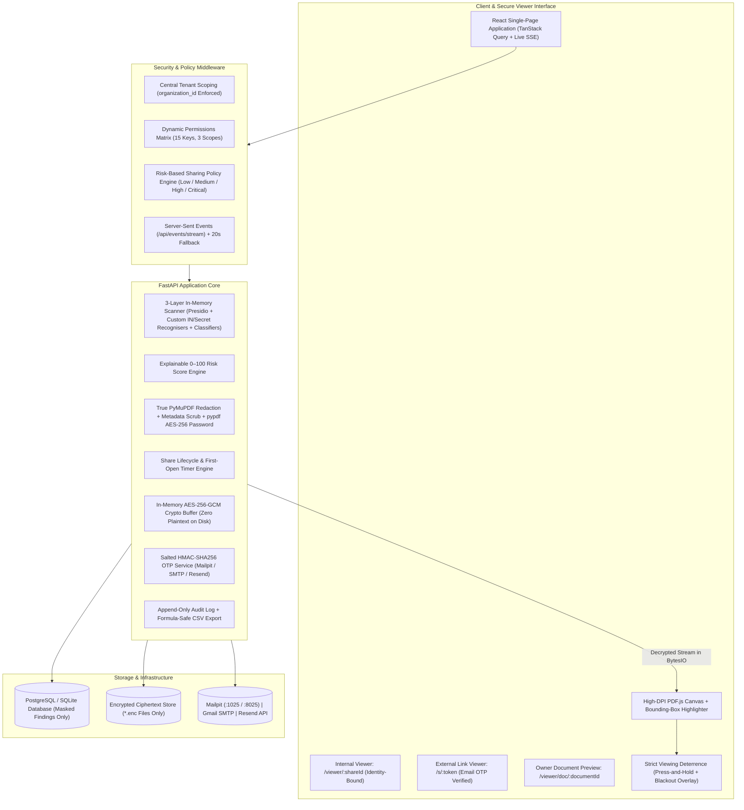

# SecureDocs AI — Sensitive Document Control, NLP Risk Analysis & Redaction Platform

**SecureDocs AI** is a multi-tenant sensitive document control, explainable risk analysis, and true PDF redaction platform built with FastAPI (Python) and React (TypeScript). When a document is uploaded, SecureDocs AI encrypts it at rest with AES-256-GCM, scans it strictly in memory using a 3-layer NLP and pattern detection pipeline, assigns an explainable risk score from `0` to `100` (`LOW`, `MEDIUM`, `HIGH`, `CRITICAL`), enforces risk-based sharing policies, and generates redacted, AES-256 password-encrypted safe copies.

---

## 1. System Architecture



---

## 2. Sensitive Data Detection, Explainable Risk Score & Redaction (PART B)

### A. Accepted Formats & In-Memory Encryption
- **Supported Uploads:** `.pdf`, `.docx`, and `.txt`. `.docx` and `.txt` files are converted to PDF in memory on upload so canvas viewing, bounding-box highlighting, and true PDF redaction work identically across all formats.
- **Zero Plaintext on Disk:** Uploaded files are encrypted with AES-256-GCM before storage (`storage_encrypted/*.enc`). Decryption for scanning, viewing, and redacting happens exclusively in memory (`io.BytesIO`).
- **Zero Raw Sensitive Values in Database or Logs:** `DocumentFinding` stores only the entity type, category, masked preview (`XXXX XXXX 4821`, `ABCDE****F`, `a****@northwind.test`), salted SHA-256 `value_hash` (to count unique occurrences), page number, bounding boxes (`[x0, y0, x1, y1]`), confidence, detector name, and a masked ~60-character context snippet.

### B. Three-Layer Detection Pipeline (`backend/app/services/scanner/`)
1. **Layer 1 — Presidio + spaCy NER:** Detects `PERSON`, `EMAIL_ADDRESS`, `PHONE_NUMBER`, `LOCATION`, `DATE_TIME`, `CREDIT_CARD` (with Luhn validation), `IBAN_CODE`, `IP_ADDRESS`, `URL`, `MEDICAL_LICENSE`, `ORG`, and `MONEY`. Falls back gracefully from `en_core_web_lg` to `en_core_web_sm` if the large model is unavailable.
2. **Layer 2 — Custom Indian & Secret Recognisers (`recognizers.py`):**
   - `IN_AADHAAR`: 12 digits (optionally spaced `4-4-4`), first digit `2–9`, validated with the full **Verhoeff checksum** algorithm, boosted by context words (`"aadhaar"`, `"uid"`).
   - `IN_PAN`: `[A-Z]{5}[0-9]{4}[A-Z]`, boosted by `"pan"`, `"income tax"`.
   - `IN_GSTIN`, `IN_IFSC`, `IN_UPI_ID`, `IN_PASSPORT`, `IN_VOTER_ID`, `IN_VEHICLE_REG`, `IN_PHONE` (`+91` / 10 digits starting `6–9`).
   - `BANK_ACCOUNT`: 9–18 digits matched only when near banking context words (`"account"`, `"a/c"`, `"acct"`, `"beneficiary"`, `"iban"`, `"ifsc"`).
   - `SECRETS`: AWS access keys (`AKIA...`), PEM private key blocks (`-----BEGIN ... PRIVATE KEY-----`), JWT tokens, generic API keys near `"api_key"`/`"secret"`/`"token"`, and `"password: <value>"` patterns.
3. **Layer 3 — Document-Level Classifiers:** Keyword and phrase scoring across `FINANCIAL`, `HEALTH`, `LEGAL`, `HR`, `CREDENTIALS`, and explicit markings (`"confidential"`, `"internal only"`, `"restricted"`, `"do not distribute"`).

### C. Explainable Risk Score (`0–100`) (`risk.py`)
- **Diminishing Returns per Entity Type:** $\text{score}_e = \min\left(\text{cap}_e,\; w_e \times \overline{\text{conf}}_e \times (1 + \log_2(n_{\text{unique}}))\right)$
- **Co-Occurrence & Structural Bonuses:**
  - Identity + Government ID (`PERSON` + `IN_AADHAAR`/`IN_PAN`/`IN_PASSPORT`)
  - Person + Clinical/Health data
  - Person + Financial account (`BANK_ACCOUNT`/`CREDIT_CARD`)
  - Active credentials / cryptographic keys (`SECRETS`)
  - Multi-page spread bonus & explicit confidentiality markings
- **Risk Levels:**
  - `0–25`: **LOW** (Green)
  - `26–50`: **MEDIUM** (Amber)
  - `51–75`: **HIGH** (Orange)
  - `76–100`: **CRITICAL** (Red)

### D. Risk-Based Sharing Policy & True PDF Redaction (`redactor.py`)
- **Low:** Internal and external sharing allowed; optional OTP and watermark.
- **Medium:** External links require email OTP and forced watermark.
- **High:** Downloads disabled on originals; strict viewing forced; external sharing requires a **Redacted Safe Copy** (or internal time-limited share).
- **Critical:** Direct sharing blocked (`HTTP 403`, logged as `SHARE_BLOCKED_BY_RISK_POLICY`). Senders must either create a **Safe Copy** or submit an **Owner/Admin Approval Request** (`/approvals`).
- **True PDF Redaction:** Safe copies use PyMuPDF (`page.add_redact_annot` + `page.apply_redactions`) to permanently delete underlying characters and glyphs from the PDF stream (verified by re-extracting text in tests), scrub PDF metadata/XMP/attachments, optionally encrypt the output PDF with AES-256 password protection via `pypdf`, and re-scan the redacted document to prove its reduced risk score.

---

## 3. Where Do OTP Emails Go? (`MAIL_MODE`)

External share links (`/s/:token`) require the recipient to verify their email address with a 6-digit one-time verification code before the document opens or the access timer starts. Email delivery is controlled by the `MAIL_MODE` environment variable:

### Mode 1: `MAIL_MODE=mailpit` (Default for Local Development)
- Sends OTP and invitation emails via SMTP (`127.0.0.1:1025`) to Mailpit.
- **Where to read OTP codes:** Open **`http://localhost:8025`** in your browser (or query `GET http://localhost:8025/api/v1/messages` / `GET http://localhost:8000/api/mailpit/messages`).
- SecureDocs AI includes an embedded Mailpit-compatible SMTP (`:1025`) and Web Inbox/API server (`:8025`) that starts automatically if an external Mailpit container is not already running.

### Mode 2: `MAIL_MODE=smtp` (Real SMTP / Gmail App Password)
- Sends real emails through any standard SMTP server (`STARTTLS` on port `587` or `SSL/TLS` on port `465`).
- **Environment variables:**
  ```env
  MAIL_MODE=smtp
  SMTP_HOST=smtp.gmail.com
  SMTP_PORT=587
  SMTP_USER=your.address@gmail.com
  SMTP_PASSWORD=xxxx xxxx xxxx xxxx
  MAIL_FROM=SecureDocs AI <your.address@gmail.com>
  ```
- **How to set up a Gmail App Password:**
  1. Go to your Google Account → **Security** (`https://myaccount.google.com/security`).
  2. Enable **2-Step Verification** if it is not already enabled.
  3. Search for **App passwords** at the top of the Google Account page (or visit `https://myaccount.google.com/apppasswords`).
  4. Enter an app name (e.g., `SecureDocs AI`), click **Create**, and copy the 16-character generated password.
  5. Set `SMTP_USER` to your Gmail address and `SMTP_PASSWORD` to that 16-character App Password.

### Mode 3: `MAIL_MODE=resend` (Resend HTTP API)
- Dispatches transactional emails via the Resend REST API (`https://api.resend.com/emails`).
- **Environment variables:**
  ```env
  MAIL_MODE=resend
  RESEND_API_KEY=re_your_api_key_here
  MAIL_FROM=security@yourdomain.com
  ```

> **Security Note:** On startup, SecureDocs AI logs which `MAIL_MODE` is active and whether the SMTP connection check succeeded, but **never** logs OTP codes in any log output or console trace.

---

## 4. View-Once Screenshot Deterrence & Future Work (Hardware DRM)

### Browser Deterrence Controls (Active on View-Once, Strict Viewing, and High/Critical Documents)
Browsers cannot fully block operating-system screenshots, so SecureDocs AI combines honest disclosure with layered deterrence:
1. **Press and Hold to View:** The document canvas is blurred by default (`filter: blur(18px)`) and becomes clear only while the viewer holds down the mouse button or touch pointer.
2. **Instant Blackout Overlay:** The entire viewer (including watermark layer) is immediately covered by an opaque black screen on `window` `blur`, `document.visibilitychange` (`hidden`), `mouseleave`, `PrintScreen` `keyup`, `Cmd/Ctrl+Shift+3/4/5`, `Win+Shift+S`, or DevTools window-size delta detection. Content returns only when the user clicks back into the page.
3. **Clipboard Overwrite:** On `PrintScreen` `keyup`, the viewer attempts `navigator.clipboard.writeText("")` where permitted by the browser.
4. **Heavy Forensic Diagonal Watermark:** Repeats the viewer's name, verified email, IP address, UTC timestamp, and share ID across every page.
5. **Audit & Sender Alert:** Every suspected capture trigger writes `SCREENSHOT_ATTEMPT_SUSPECTED` (with trigger type) to the immutable audit log and notifies the sender in real time.

### Future Work: Hardware DRM (Widevine / FairPlay via Encrypted Media Extensions)
Standard HTML5 Canvas and DOM elements are composited in the operating system's unencrypted window buffer, which means native OS screen-capture utilities can still capture pixels before browser events fire. To make OS-level screenshots and screen recordings appear completely **black** at the hardware/compositor level, future work would render document pages as encrypted video frames delivered through the browser's **Encrypted Media Extensions (EME)** API backed by hardware DRM (**Google Widevine L1** on Chrome/Windows/Android and **Apple FairPlay Streaming** on Safari/macOS/iOS). Implementing hardware DRM requires a commercial Widevine/FairPlay licensing agreement and a dedicated DRM license server.

---

## 5. Seed Accounts, Shares & B8 Test Documents

**Universal Password for all seeded users:** `Test@1234`

### Organization 1: Northwind Health (`NWH-2026`)
- **Owner:** `meera@northwind.test` (Meera Krishnan)
- **Admin:** `daniel@northwind.test` (Daniel Joseph)
- **Finance Dept:** `ananya@northwind.test` (Dept Head), `karthik@northwind.test` (Manager), `divya@northwind.test` (Employee), `farhan@northwind.test` (Employee)
- **Clinical Dept:** `rahul@northwind.test` (Dept Head), `lakshmi@northwind.test` (Employee)
- **Pending Member:** `newjoiner@northwind.test` (Sanjay K)

### Organization 2: Orbitline Systems (`ORB-2026`)
- **Owner:** `neha@orbitline.test` (Neha Gupta)
- **Employee:** `tom@orbitline.test` (Tom Mathew)

### Seeded B8 Documents & Risk Scores
| Document Filename | Score | Risk Level | Key Sensitive Findings |
|---|---|---|---|
| `HR_Employee_Master.pdf` | `100/100` | **CRITICAL** | 6 employee rows with valid Verhoeff Aadhaar numbers, PANs, bank accounts, IFSC, phone numbers, emails, and salaries |
| `Patient_Discharge_Summary.pdf` | `69/100` | **HIGH** | Patient name, phone, Aadhaar, clinical diagnosis (ICD-10), prescriptions, and medical registration number |
| `Vendor_Invoice_Medisupply.pdf` | `48/100` | **MEDIUM** | Supplier GSTIN, PAN, corporate bank account, IFSC, billing contact, and invoice line items |
| `Team_Offsite_Agenda.pdf` | `9/100` | **LOW** | First names and generic agenda dates only |
| `Dev_Server_Notes.pdf` | `100/100` | **CRITICAL** | Sample AWS access key (`AKIA...`), PEM private key block, production DB password, and internal IP addresses |

---

## 6. How to Run Locally & Execute Tests

```bash
# 1. Seed the database and scan all sample documents
PYTHONPATH=backend ./venv/bin/python backend/app/seed.py

# 2. Start the FastAPI backend (port 8000, embedded Mailpit on :1025 / :8025)
PYTHONPATH=backend ./venv/bin/uvicorn app.main:app --host 127.0.0.1 --port 8000

# 3. Start the React frontend (port 5173)
cd frontend && npm run dev

# 4. Run Backend Unit & Integration Tests (PART A & B)
PYTHONPATH=backend ./venv/bin/pytest backend/tests/test_part_a_b.py -v

# 5. Run Playwright E2E & Visual QA Suite (PART C)
./venv/bin/python tests_e2e_part_abc.py
```

---

## 7. Email Delivery Configuration (Gmail SMTP & In-App Demo Inbox)

SecureDocs AI supports two delivery modes for external link OTP verification codes:

### A. Development Mode (Default: In-App Demo Inbox)
```env
MAIL_MODE=demo
DEMO_MODE=true
```
In development mode, verification codes sent to external recipients are captured directly inside the embedded store and accessible via the **Demo inbox** (`/demo-inbox`) inside SecureDocs AI (available in the sidebar under Activity to Owners and Admins). External viewers see verification codes directly inside the demo inbox without requiring any third-party website.

### B. Production Gmail SMTP Setup
To deliver real verification emails to recipients via Gmail SMTP, configure your `.env`:
```env
MAIL_MODE=smtp
SMTP_HOST=smtp.gmail.com
SMTP_PORT=587
SMTP_USER=your-address@gmail.com
SMTP_PASSWORD=your-16-char-gmail-app-password
SMTP_FROM=your-address@gmail.com
```

**Steps to generate a Gmail App Password:**
1. Sign in to your Google Account and navigate to **Security** → **2-Step Verification**.
2. Scroll to the bottom and select **App passwords**.
3. Create a new app password named `SecureDocs AI`.
4. Copy the generated 16-character password into `SMTP_PASSWORD` in `.env`.
5. Restart the backend service.

